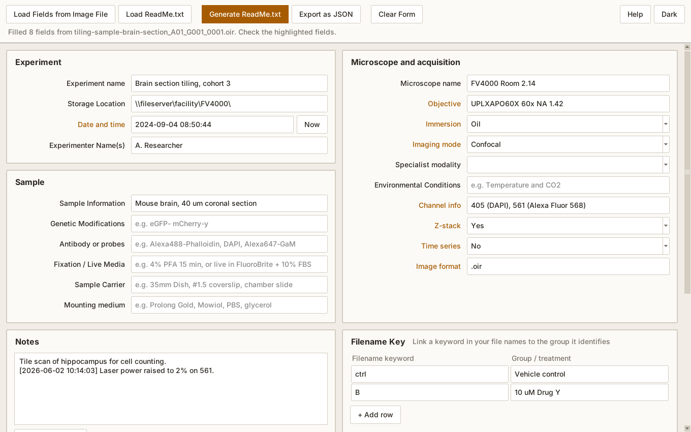

<div align="center">

# ReMInD

**Recommended Metadata Interface for Documentation**

A small Windows program that promotes FAIR data management practices in microscopy<br>
by making it easy to record metadata at the point of acquisition.

[](https://github.com/L-Howell/ReMInD/actions/workflows/ci.yml)
[](https://github.com/L-Howell/ReMInD/releases/latest)
[](LICENSE)


[Download](https://github.com/L-Howell/ReMInD/releases/latest) ·
[User guide](docs/user-guide.md) ·
[Troubleshooting](docs/troubleshooting.md) ·
[Developer guide](docs/developer-guide.md)

</div>

<picture>
  <source media="(prefers-color-scheme: dark)" srcset="docs/images/remind-dark.png">
  
</picture>

## What it does

Image files record how they were acquired, but not what the sample was or why it was
imaged. ReMInD is a single form that makes it easy to record everything: sample, labels,
fixation, storage location, notes. Load one of your image files and it fills in what the
file already contains, such as the objective, the channels and the acquisition date.

The result is a plain-text file that anyone can read without needing ReMInD:

```text
Experiment name: Brain section tiling, cohort 3
Storage Location: \\fileserver\facility\FV4000\
Date and time: 2024-09-04 08:50:44
Sample Information: Mouse brain, 40 um coronal section
Microscope name: FV4000 Room 2.14
Objective: UPLXAPO60X 60x NA 1.42
Immersion: Oil
Channel info: 405 (DAPI), 561 (Alexa Fluor 568)
Z-stack: Yes

# Filename Key
ctrl -> Vehicle control
B -> 10 uM Drug Y
```

The same content can be exported as JSON for other software.

## Getting it

Download `ReMInD.exe` from the [latest release](https://github.com/L-Howell/ReMInD/releases/latest)
and run it. Installation is not required. It runs on Windows 10 and 11.

## Using it

1. Click <kbd>Load Fields from Image File</kbd> and choose one of your image files.
   The fields it fills in are highlighted so you can check them.
2. Fill in the rest. Empty fields show an example of what to enter.
3. Click <kbd>Generate ReadMe.txt</kbd> and save it in the same folder as your image data.

To update a record later, open it with <kbd>Load ReadMe.txt</kbd>. The
[user guide](docs/user-guide.md) covers the Filename Key, templates and JSON export.

## Supported image files

| Format | Microscopes | Read with |
|---|---|---|
| `.czi` | Zeiss | [pylibCZIrw](https://github.com/ZEISS/pylibczirw) |
| `.lif` | Leica | [readlif](https://github.com/Arcadia-Science/readlif) |
| `.nd2` | Nikon | [nd2](https://github.com/tlambert03/nd2) |
| `.oir` | Evident / Olympus | [oirfile](https://github.com/cgohlke/oirfile) |
| `.ome.tif` | Any that writes OME-TIFF | [ome-types](https://github.com/tlambert03/ome-types) |

A file that holds several images, such as a Leica project, is read in full. Settings
that differ between its images are all listed.

> [!NOTE]
> The amount and type of metadata a file can supply depends on the format, microscope,
> and controlling software version. Always check the highlighted fields. The form also
> works without an image file.

## For facilities

> [!TIP]
> Put a template next to `ReMInD.exe` on an acquisition PC and every user starts with
> the same storage location and instrument name pre-filled.

Copy [`templates/example_ReadME_template.txt`](templates/example_ReadME_template.txt),
edit its two values, and give it a name ending in `_ReadME_template.txt`. See
[Templates](docs/user-guide.md#4-templates) in the user guide.

## For developers

<details>
<summary>Run from source, test and build</summary>

```bash
git clone https://github.com/L-Howell/ReMInD.git
cd ReMInD
pip install -r requirements.txt
python src/remind.py                    # run from source (Python 3.12+)
python -m unittest discover -s tests    # run the tests
```

To build the executable, run `build_scripts/build.bat` from the `build_scripts` folder.
Every pull request is also tested and built on Windows by CI, and the resulting
`ReMInD.exe` is attached to each run. Pushing a version tag such as `v4.0.0` publishes a
release.

The [developer guide](docs/developer-guide.md) explains the code layout, how to add a
file format, how to change the colours, and the release steps.

</details>

## Credits and licence

ReMInD was created by Dr Nicholas Condon (Institute for Molecular Bioscience Microscopy
Facility, The University of Queensland) as [NickCondon/Remind](https://github.com/NickCondon/Remind).
This version is developed and maintained independently by Liam Howell (Sydney Microscopy
and Microanalysis, The University of Sydney).

Released under the [GNU General Public License v3.0](LICENSE). To report a problem or
ask for a feature, [open an issue](https://github.com/L-Howell/ReMInD/issues).
